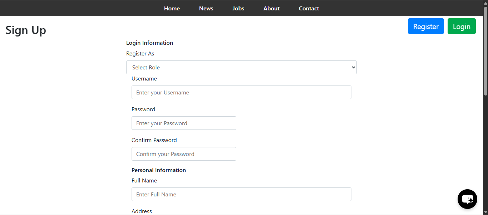
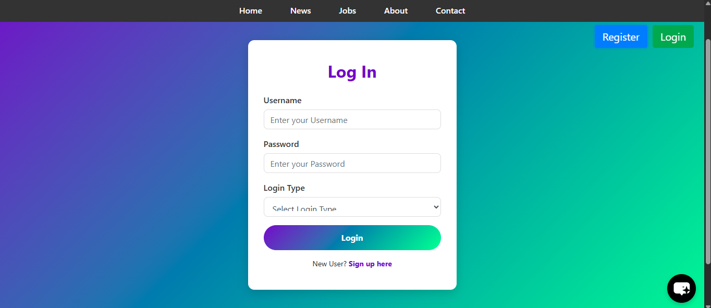
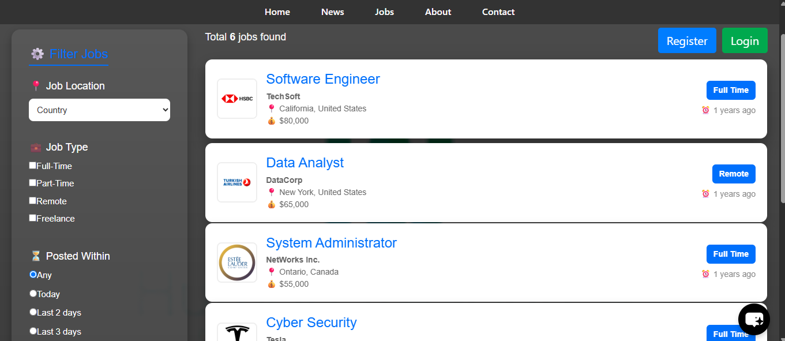
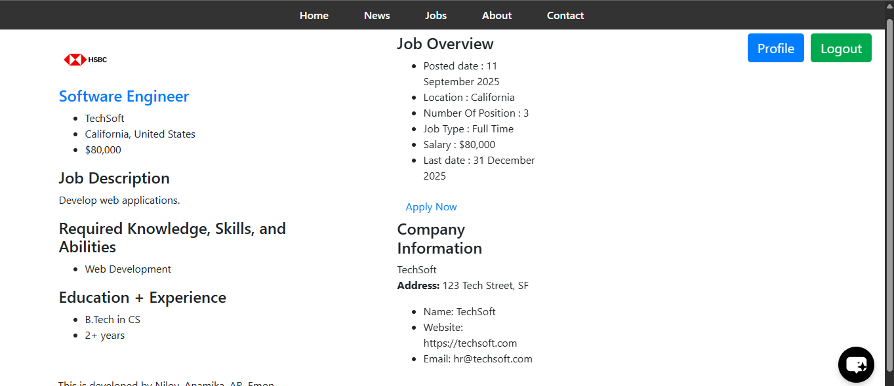
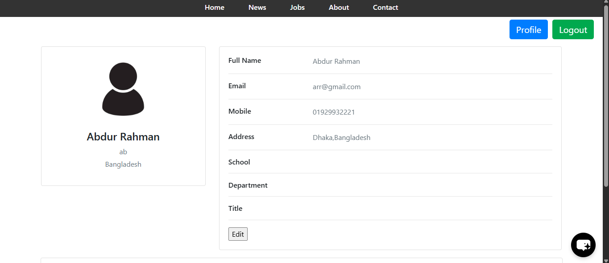
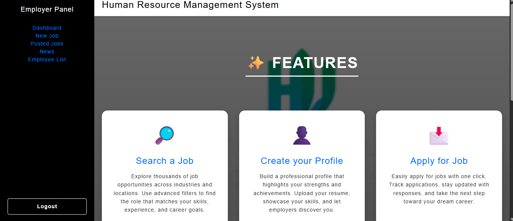
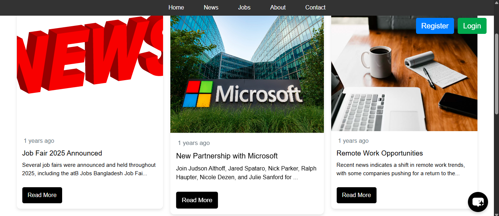
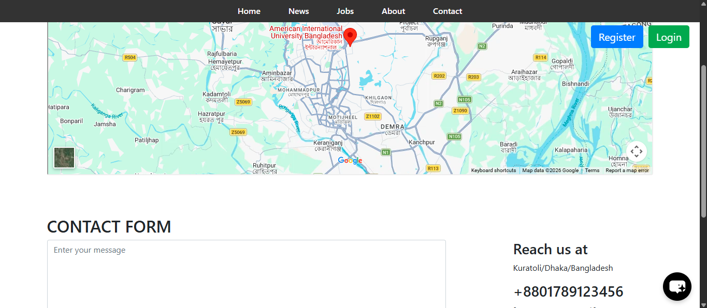
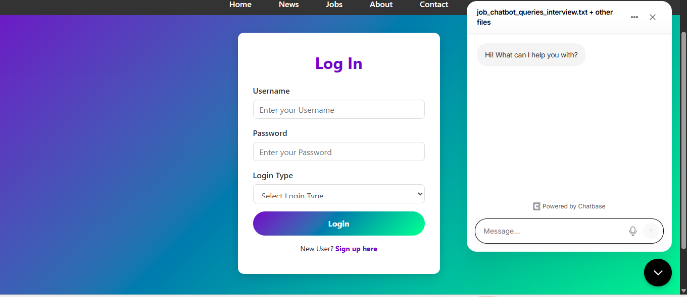

# Job Finder — Job Portal & Human Resource Management System

A role-based **job portal and human resource management web application** built using **ASP.NET Web Forms (C#)** and **Microsoft SQL Server**. Job seekers can explore vacancies, apply for jobs, and manage their profiles, while employers can publish job advertisements, review applicants, manage employees, and submit ratings. An admin panel provides oversight of users, content, reviews, and recorded payments.

> **Project status:** Academic / demonstration project. The payment screen records a submitted amount in the database; it is **not connected to a real payment processor** and must not be presented as a verified financial transaction.

## screenshot

### Registration and authentication

| Sign up | Log in |
| --- | --- |
|  |  |

### Explore the platform

| Job listings and filters | Job details |
| --- | --- |
|  |  |

### User profile and employer dashboard

| Job seeker profile | Employer dashboard |
| --- | --- |
|  |  |

### Other pages

| News | Contact page |
| --- | --- |
|  |  |

### Chat assistant



The screenshot show example/demo data and the current application interface.

## Features

### Job seeker
- Register and log in with a job seeker account.
- Browse available jobs and open detailed job descriptions.
- Filter listings by country, employment type, and posting recency.
- Apply to a vacancy and manage profile / résumé information.
- Read news and use the contact page.

### Employer
- Log in to a dedicated employer dashboard.
- Create job advertisements with role details, requirements, salary, location, and company logo.
- Use a **Proceed Payment** step before a new job is saved; the demonstration flow records a payment entry linked to the newly generated `JobId`.
- View the employer's posted jobs and their applicants.
- Filter applicants by **country AND minimum average review rating** (0–10).
- View applicant profiles, accept or reject applications.
- Add accepted applicants to the employer's employee list.
- View/remove employees and submit written reviews with a rating from 0 to 10.

### Administrator
- Access a dedicated admin dashboard.
- View/manage user accounts, job records, news items, contact messages, and reviews.
- View payment history, including payer username, job ID, amount, date, and time.

### Additional interface features
- Bootstrap-based UI and role-specific navigation.
- News pages, contact form, and embedded map.
- Embedded third-party chat widget shown in the screenshot (availability depends on its external service/configuration).

## Technology stack

| Layer | Technology |
| --- | --- |
| Application | ASP.NET Web Forms, C# |
| Framework | .NET Framework **4.7.2** |
| Database | Microsoft SQL Server, ADO.NET (`System.Data.SqlClient`) |
| Front end | HTML, CSS, JavaScript, Bootstrap, jQuery |
| Development | Visual Studio, IIS Express / IIS |

## Project structure

```text
Job-Finder-Website V4/
├── Admin/             # Admin dashboard and management pages
├── Employer/          # Employer, applicant, employee, review and payment pages
├── User/              # Public pages, authentication, jobs and user profiles
├── Images/            # UI images and uploaded company logos
├── SQL Files/         # Included SQL reference files (see note below)
├── assets/            # Front-end assets
├── JobFinder.sln      # Visual Studio solution
├── JobFinder.csproj   # ASP.NET Web Forms project
└── Web.config         # Application settings and DB connection string

screenshot/             # Place beside README.md at repository root
README.md
```

## Running locally

### Requirements
- **Windows** with Visual Studio (ASP.NET and web development workload).
- **.NET Framework 4.7.2** targeting/developer pack.
- **SQL Server** (SQL Server Express or another compatible local instance).
- A database named `JobFinderDB`, or update the configured catalog name.

### Setup

1. Clone or download the repository and open **`JobFinder.sln`** in Visual Studio.
2. Restore NuGet packages if Visual Studio prompts you to.
3. Set up the SQL Server database and create the tables needed by your version of the application.
4. In **`Web.config`**, update the `JobFinderDB` connection string to point to **your own SQL Server instance**, for example:

   ```xml
   <connectionStrings>
     <add name="JobFinderDB"
          connectionString="Data Source=.\SQLEXPRESS;Initial Catalog=JobFinderDB;Integrated Security=True"
          providerName="System.Data.SqlClient" />
   </connectionStrings>
   ```

5. Confirm the application account has the necessary read/write permissions and that folders used for logo uploads are writable.
6. Build the solution and run it using **IIS Express** (or an appropriately configured IIS site).
7. Register a test account and sign in using the appropriate role to explore its pages.

**Database note:** The repository's `SQL Files/` directory contains SQL references for some tables, but it is **not a verified complete, executable migration** for the latest project. The current application also uses tables such as `Employees`, `Review`, and `Payment`, and expects `Jobs.UserId`. You must provide a schema matching the application before all features will work. Do **not** execute the files blindly or assume the database can be rebuilt from those files alone.

## Main database relationships

| Table | Purpose / relevant relationship |
| --- | --- |
| `[User]` | Accounts and profile information; `UserId` identifies a user |
| `Jobs` | Job advertisements; `JobId` identifies a vacancy, `UserId` identifies its employer |
| `AppliedJobs` | Job applications; maps `JobId` to applicant `UserId` |
| `Employees` | Employer–employee association; `EmployerId` and `EmployeesId` |
| `Review` | Reviews; `GiverUserId`, `ReceiverUserId`, `Review`, `Rating` |
| `Payment` | Demo payment records; `PaymentId`, `JobId`, `UserId`, `PaymentAmount`, `PaidAt` |
| `Country` | Country options used by forms/filters |
| `News` / `Contact` | News content and contact requests |

A new job is saved with a generated `Jobs.JobId`; the same value is then stored in `Payment.JobId` when the demo payment form is submitted.

## Important notes

- **Payment simulation only:** The form does not charge a card, verify a bank transfer, or integrate with a payment service. A production system should record payments only after trusted provider-side verification.
- **Security:** Before production deployment, review password handling (use modern salted password hashes), authorization and record ownership checks, SQL parameterization, upload validation, error handling, and secret management. The sample project should be treated as a learning/demo application, not production-hardened software.
- **Configuration:** Replace local machine-specific database connection details. Avoid committing credentials, production databases, private user data, or secret API keys.
- **Third-party integrations:** The chat widget and embedded map may depend on external services and internet access.

## screenshot folder

All images used above are in [`screenshot/`](screenshot/). Keep that folder and `README.md` together in the repository root so GitHub can render the relative image paths correctly.

## License

No license has been specified. Add a `LICENSE` file if you want to define how others may reuse or redistribute the project.
